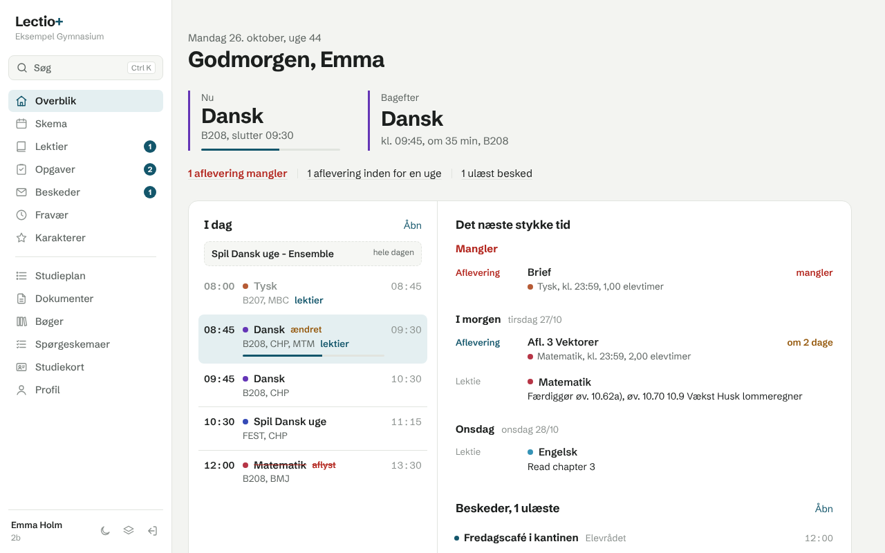

# Lectio+

Et roligere og mere overskueligt Lectio. Lectio+ er en Chrome-udvidelse der lægger sig oven på lectio.dk og bruger dit eget login.

## Det får du

- Overblik over din dag med næste modul og lokale
- Lektier og afleveringer samlet pr. dag
- Nyt ugeskema hvor du klikker på et modul og ser lektier og noter
- Egne sider til opgaver og lektier samt fravær og karakterer
- Flueben på lektier
- Mørk tilstand på hele Lectio
- Hurtig søgning med Ctrl+K

## Privatliv

Udvidelsen har ingen server og sender ingen data nogen steder hen. Læs hele [privatlivspolitikken](https://gustavgamer123.github.io/lectio-plus/privatliv/).

## Installér fra koden

1. Download repoet og åbn `chrome://extensions`
2. Slå Udviklertilstand til
3. Klik Indlæs upakket og vælg mappen `extension`

## Bemærk

Lectio+ er et uafhængigt projekt og er ikke lavet af eller tilknyttet MaCom A/S eller Lectio.

Skrifttypen Schibsted Grotesk er udgivet under SIL Open Font License.
