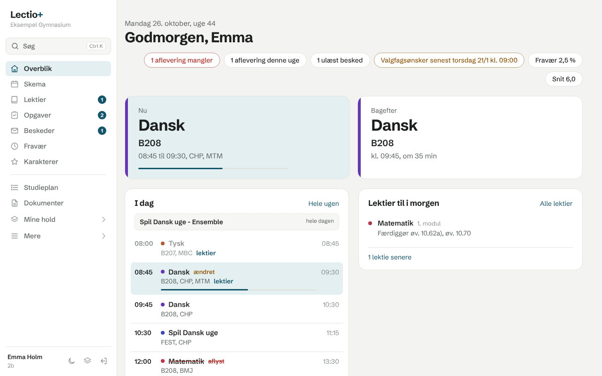

# Lectio+

Et roligere og mere overskueligt Lectio. Se [hjemmesiden](https://gustavgamer123.github.io/lectio-plus/). Lectio+ er en Chrome-udvidelse der lægger sig oven på lectio.dk og bruger dit eget login.

## Det får du

- Nyt design på alle sider i Lectio, i samme stil som Lectio selv, i lyst og mørkt tema
- Forside med næste modul og lokale, dagens skema, lektier, afleveringer og beskeder
- **Hvad er ændret:** flyttede og aflyste moduler, nye opgaver, lektier og beskeder siden sidst
- **Klar til i morgen:** om aftenen viser Forside næste skoledag med lektier og din egen huskeliste
- Ugeskema delt op efter tid; klik på et modul og se lektier og noter
- Egne sider til opgaver, lektier, beskeder (med læsepanel), fravær, karakterer og studieplan
- **Fraværsberegner**, **snit-simulator** og **travle uger**
- Notifikationer om nye lokaler, aflysninger, beskeder og frister, hvis du slår dem til
- Din egen farve til hvert fag, flueben på lektier og hurtig søgning med Ctrl+K

## Privatliv

Udvidelsen har ingen server og sender ingen data nogen steder hen. Alt hentes fra lectio.dk og gemmes på din egen computer. Slår du notifikationer til, tjekker Lectio+ lectio.dk med jævne mellemrum, også når Lectio er lukket. Læs hele [privatlivspolitikken](https://gustavgamer123.github.io/lectio-plus/privatliv/).

## Installér

Hent den gratis i [Chrome Web Store](https://chromewebstore.google.com/detail/lectio+/lbepaknpejokimbpdockkabmpcphcknm).

### Fra koden

1. Download repoet og åbn `chrome://extensions`
2. Slå Udviklertilstand til
3. Klik Indlæs upakket og vælg mappen `extension`

Tests: `npm install` og `npm test`.

## Bemærk

Lectio+ er et uafhængigt projekt og er ikke lavet af eller tilknyttet MaCom A/S eller Lectio.

Skrifttyperne IBM Plex (udvidelsen) og Schibsted Grotesk (hjemmesiden) er udgivet under SIL Open Font License.
